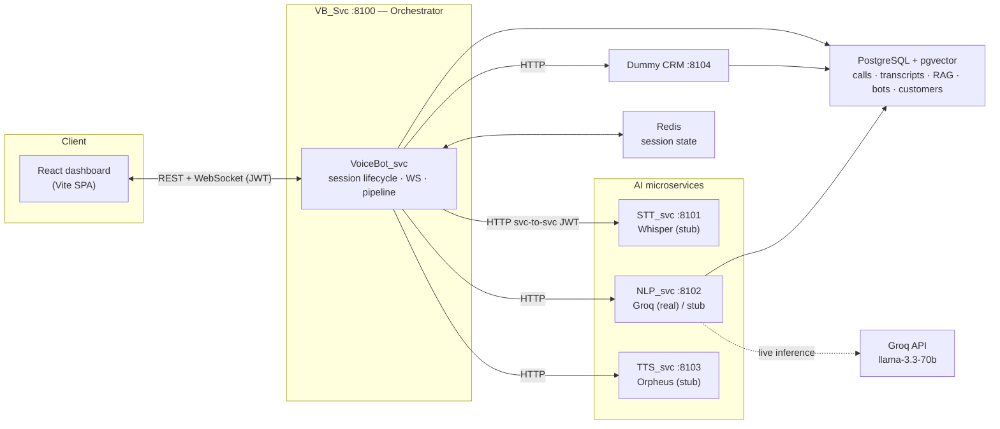
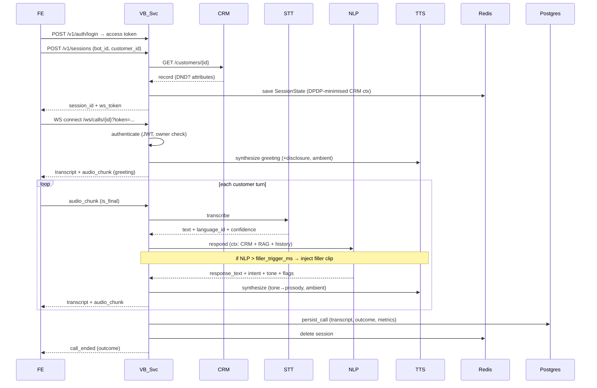
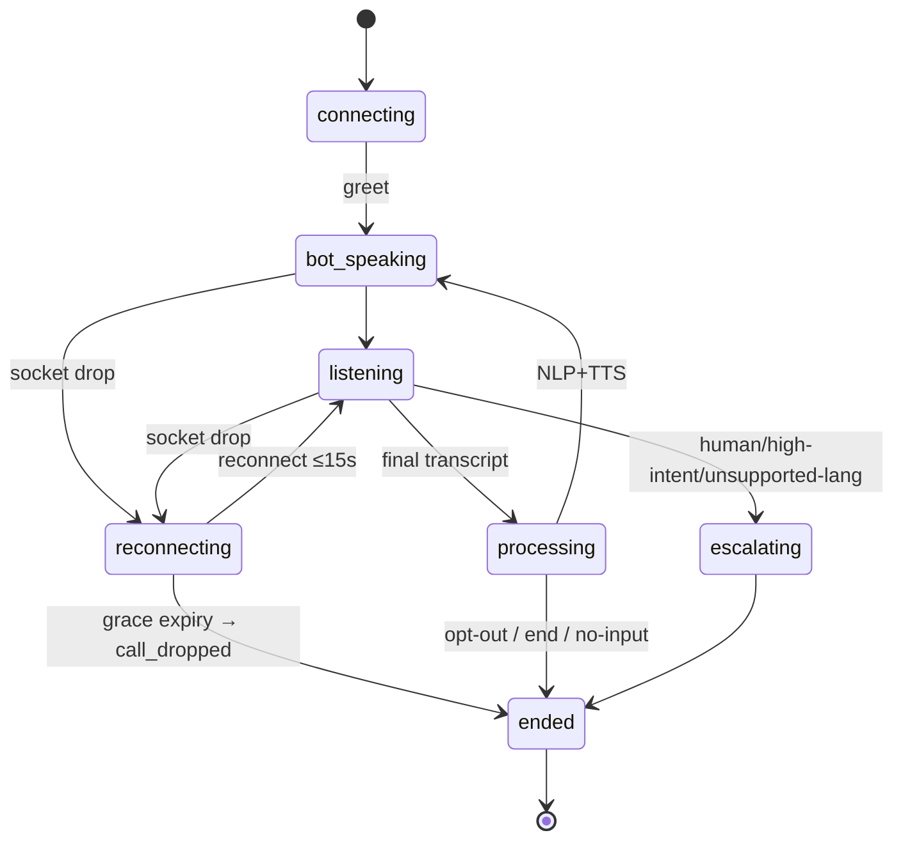
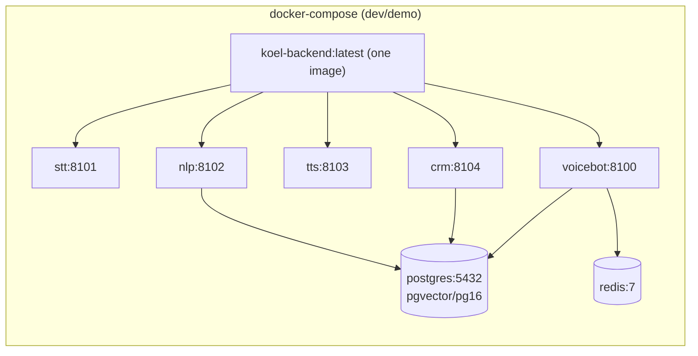

# KOEL Voice Bot — High-Level Design (HLD)

> **⚠️ Superseded — see [`HLD_V2.md`](./HLD_V2.md) for the current system.**
> This document reflects the initial MVP boilerplate and is kept for historical
> reference only.

> Status: reflects the implemented MVP (backend + demo frontend) as validated against
> `koel-voice-bot-prd-v1.2.html`. Companion document: [LLD.md](./LLD.md).

---

## 1. Purpose & scope

KOEL is a low-latency, multilingual (English / Hindi / Hinglish) **outbound voice-bot
platform for Indian financial services** — credit-card cross-sell, pre-due collections,
personal-loan and insurance pitches. The design thesis (PRD §01) is that **sub-300 ms
conversational turn latency is the product**; everything else (use case, persona, script,
CRM mapping) is *configuration*, not code.

This HLD covers the system architecture, the major data flows, and the cross-cutting
concerns (auth, observability, resilience, compliance). Method- and field-level detail is
in the [LLD](./LLD.md).

---

## 2. Goals & non-functional requirements

| Dimension | Target (PRD §02/§14) | How the design serves it |
|---|---|---|
| Turn latency | <300 ms P95 (audio-in → audio-out) | Persistent WebSocket; streaming AI svcs; per-hop OTel spans; pre-rendered filler audio masks slow turns |
| Languages | EN / HI / Hinglish, mid-call switch | Per-utterance `language_id`; orchestrator switches `state.language`; graceful fallback + escalate on unsupported langs |
| Intent accuracy | >85% | LLM (Groq) classification with forced JSON schema; heuristic stub fallback |
| Barge-in stop | <150 ms confirmed-interrupt → silence | Dual-gated interruption engine; `TTS_KILL` over the socket |
| Session recovery | 15 s grace, resume by Session ID | Redis grace-TTL + reconnect path + dropped-call finalizer |
| Tone coverage | 100% of NLP turns carry a tone tag | `tone` is a required field on `NlpResponse`; TTS maps tone → prosody |
| Auth | 100% REST + WS JWT-validated | JWT bearer on every REST route; short-lived WS token validated *before* upgrade |
| Observability | Distributed trace FE→VB→AI | W3C trace-context inject/extract + manual per-hop spans + correlation id |
| Statelessness | No in-memory app state | All call state in Redis with TTL → horizontal scale, no sticky sessions |

---

## 3. System context

The orchestrator owns the conversation; the AI services are stateless and independently
swappable. Each AI/CRM call carries a service-to-service JWT and a propagated correlation +
W3C trace context.

---

## 4. Component responsibilities

| Component | Module | Port | Responsibility |
|---|---|---|---|
| **Frontend** | `src/App.tsx` + `src/lib/koel.ts` | (Vite) | Login, bot dashboard, config panel, **active-call** (WS, transcript, waveform, CRM panel, state badge), call history. Real WS client with a simulated demo fallback. |
| **VoiceBot_svc** | `koel/voicebot/*` | 8100 | The orchestration brain: REST API (auth, bots, sessions, history), authenticated WebSocket call socket, the per-turn pipeline (STT→NLP→TTS), barge-in, filler, silence, reconnect/grace, persistence. |
| **STT_svc** | `koel/stt/*` | 8101 | Speech→text; returns `language_id` + confidence per utterance. Stub provider (real Whisper/SageMaker is a `NotImplementedError` seam). |
| **NLP_svc** | `koel/nlp/*` | 8102 | Intent + RAG-grounded response + tone tag. **Real Groq provider** (OpenAI-compatible, JSON mode) selectable via config; deterministic stub otherwise. |
| **TTS_svc** | `koel/tts/*` | 8103 | Tone→prosody synthesis + ambient bed. Stub emits sized PCM; real Orpheus is a seam. |
| **Dummy CRM** | `koel/crm/*` | 8104 | Synthetic customer records behind the production CRM contract; flags (DND/opt-out/callback/retry). |
| **Shared core** | `koel/common/*`, `koel/db/*` | — | `create_app` factory, JWT auth, config, structured logging, OTel, error envelope, SQLAlchemy models + session. |

---

## 5. Technology stack

- **Backend:** Python 3.11, FastAPI (async, native WebSocket), Pydantic v2 / pydantic-settings.
- **Transport:** WebSocket (full-duplex, JSON envelopes, base64 audio) + REST (Richardson L2).
- **AI:** Groq `llama-3.3-70b-versatile` (live NLP); Whisper / Orpheus / Bedrock-Titan are interface seams (stubbed in MVP).
- **State:** Redis (session state, TTL). **Data:** PostgreSQL 16 + pgvector (calls, transcripts, bots, customers, RAG knowledge).
- **Observability:** OpenTelemetry (manual per-hop spans + W3C propagation), structured JSON logs with correlation id.
- **Frontend:** React 18 + Vite + Tailwind, lucide-react.
- **Infra (dev):** Docker Compose (Colima-compatible) — Postgres + Redis + 5 services from one image. Prod target (PRD): AWS ap-south-1, EC2 + SageMaker.

---

## 6. Key data flows

### 6.1 Outbound call — happy path

### 6.2 Conversation-resilience flows (PRD §05)

- **Barge-in (dual gate):** Gate 1 = client VAD → `barge_in_candidate`. Gate 2 = VB classifies the partial transcript: <300 ms or matches the (per-language + per-bot) backchannel dictionary → ignore; else `TTS_KILL` (carrying `stop_target_ms`), mark the bot turn `interrupted`, route the utterance as the active turn.
- **Filler:** if NLP hasn't returned within `filler_trigger_ms` (300 ms), a pre-rendered, language+tone-matched clip is injected (rotated, never twice consecutively) to mask latency.
- **No-input:** 5 s silence → re-prompt (`NO_INPUT_1` logged); a further 5 s → close as `customer_unresponsive`, CRM flagged `retry`. The timer is **independent of heartbeat pongs** (only real client frames reset it).
- **Disconnect / reconnect:** socket drop → status `reconnecting`, Redis TTL shortened to 15 s. Reconnect with same Session ID within the window → resume + `RECONNECTED` span. **No reconnect → a detached finalizer records `call_dropped`, persists the partial transcript, and flags the CRM for callback.**
- **Heartbeat:** ping every 5 s; if no pong within ~12 s the peer is declared dead and routed onto the grace path.
- **Language fallback:** unsupported language above confidence threshold → apology in Hindi/English + immediate escalation, session tagged `unsupported_language`.

---

## 7. Cross-cutting concerns

- **Authentication & authZ:** JWT bearer on every REST route; a separate short-lived **WS token** validated *before* the socket upgrades (1008 on failure); the WS token's `sub` must own the session (no eavesdropping). Internal AI/CRM calls require a `role=service` principal. Production fails fast if the default JWT secret is unchanged.
- **Observability:** every service inherits `/health`, `/docs`, structured JSON logs (level + correlation id), and OTel. The orchestrator emits manual spans per hop (`nlp.respond`, `tts.synthesize`, `ws.reconnected`…); W3C `traceparent` is injected on fan-out and extracted inbound so spans stitch into one trace. `trace_id` is persisted on each call.
- **Configuration:** 12-factor, all `KOEL_`-prefixed env vars. The same image runs dev/CI/demo; behaviour (thresholds, provider selection, calling hours) is config.
- **Error handling:** one shared error envelope (`{code, message, detail, correlation_id}`); 4xx = WARN, unhandled = 500 ERROR; AI-call failures inside a turn never crash the socket — they surface an error frame and finalize once.
- **Session lifecycle:** all call state lives in `SessionState` in Redis (TTL), serialized on every mutation → any VB instance can resume a re-bound socket.

---

## 8. Deployment view

- One image, five `uvicorn` entrypoints (module per service). `scripts/bootstrap_db.py` creates tables + pgvector extension and seeds CRM + bots + RAG (idempotent). `scripts/demo_call.py` / `demo_resilience.py` drive live calls.
- **Production target (PRD):** AWS ap-south-1 (data residency), EC2 for app services, SageMaker GPU endpoints for Whisper/Orpheus, managed Bedrock or Groq for NLP, S3 for recordings (30-day retention).

---

## 9. Compliance & security posture (PRD §11)

- **RBI:** bot self-identifies the bank + automated-call disclosure at greeting; opt-in calling-hours window refuses out-of-hours dials.
- **IRDAI:** automated disclosure spoken; consent captured with a **timestamp**; escalation to a human for binding steps.
- **DPDP:** consent at call open; **data minimisation** (only use-case-relevant CRM fields loaded into the session); PII (name) masked in logs.
- **TRAI:** DND scrub *before* dialling (409); opt-out **immediately** flags the CRM and ends the call.
- **Auditability:** per call — transcript, outcome, consent (+timestamp), `recording_url`, and `trace_id` persisted; correlation id links logs across hops.

---

## 10. Scalability & resilience

- **Stateless services** + Redis-held session → horizontal scaling without sticky sessions; a reconnect can land on any VB instance.
- **Graceful degradation everywhere:** RAG retrieval, filler, Groq NLP, and the CRM flag are all best-effort — failures degrade (stub / skip / log) rather than drop the call.
- **Exactly-once finalization** of every call (in-band end, service error, or grace-expiry drop) → no lost transcripts.
- **Provider isolation:** STT/NLP/TTS behind stable contracts → swap Groq↔Bedrock, stub↔Whisper with no orchestrator change.

---

## 11. Current state — real vs. stub

| Capability | State |
|---|---|
| NLP (intent/response/tone) | **Real Groq** (`llama-3.3-70b`), config-gated, stub fallback |
| RAG retrieval | Real pgvector query; **HashEmbedder** stub embeddings |
| STT | Stub (type-to-talk); real Whisper is a seam |
| TTS | Stub (sized PCM + ambient bed); real Orpheus is a seam |
| Orchestration, resilience, auth, compliance, observability | **Fully implemented & tested** (37 tests; verified live) |
| Frontend | Full SPA; real WS client; default demo path is simulated; type-to-talk (no mic) |

---

## 12. Risks & future work

- **Real audio path:** browser mic capture + real Whisper STT + real Orpheus TTS streaming (the current frontend sends type-to-talk text).
- **RAG quality:** swap `HashEmbedder` for Bedrock Titan / a real embedding model.
- **Telephony:** Twilio/Exotel bridge for real PSTN calls (the orchestrator is transport-agnostic by design).
- **Horizontal hardening:** Redis keyspace-notification-driven finalizer (today a per-connection detached task), multi-tenant bot management, load testing to the 10-concurrent-session demo target.
