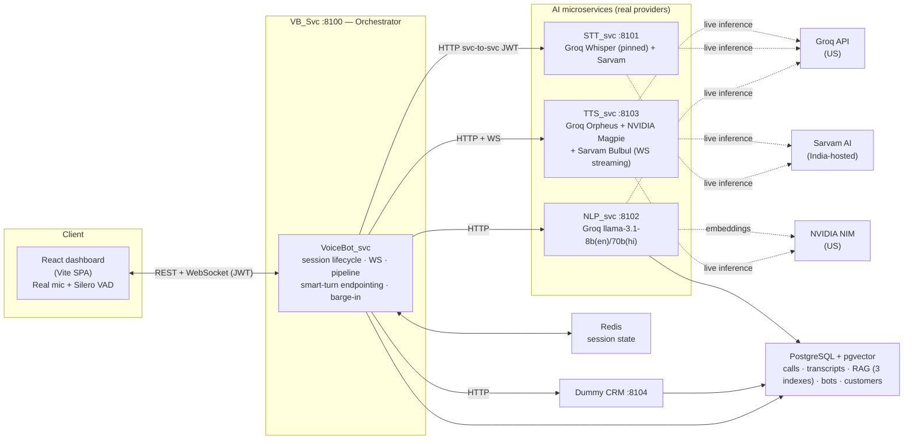
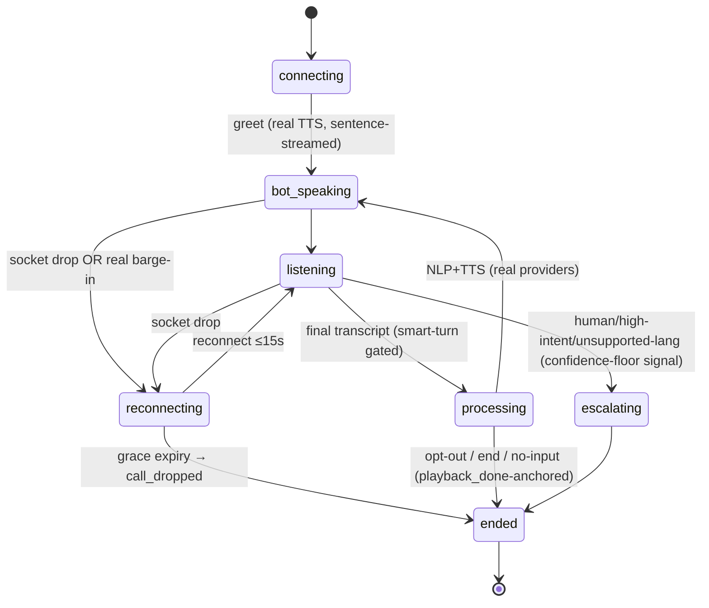
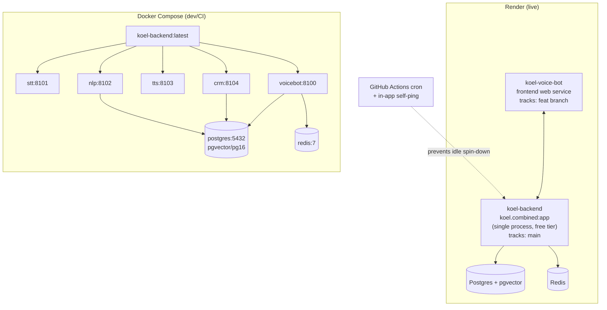

# KOEL Voice Bot — High-Level Design v2

> **Status: reflects the current, deployed system** (backend + frontend, live on
> Render). Supersedes [`HLD.md`](./HLD.md) (v1, written against the initial MVP
> boilerplate) — v1 is kept for historical reference, not deleted. Companion
> document: [`LLD_V2.md`](./LLD_V2.md). Roadmap: [`FUTURE_PROCEEDINGS.md`](./FUTURE_PROCEEDINGS.md).

---

## What changed since v1 — at a glance

v1 described a boilerplate with resilience/compliance/observability *fully
implemented* but the AI pipeline *stubbed* (STT/TTS/RAG-embeddings were sized
placeholders; NLP was the one real integration, on Groq). Since then, the AI
pipeline went fully real, a second voice provider (Sarvam) was added for
India-hosted Hindi/Hinglish, a Pipecat-inspired conversation-quality upgrade
shipped in four phases, and the whole system was deployed and load-tested live.

| Area | v1 (HLD.md) claimed | v2 (now) |
|---|---|---|
| **STT** | Stub only; "real Whisper/SageMaker is a seam" | **Real**: Groq Whisper (language-**pinned**, not auto-detect) + Sarvam STT (`saaras`); SageMaker remains a stub seam |
| **TTS** | Stub emits sized PCM; "real Orpheus is a seam" | **Real, three engines**: Groq Orpheus (English), NVIDIA Magpie (Hindi, Devanagari-only), **Sarvam Bulbul** (Hindi + Hinglish, **WebSocket streaming on by default**) — routed by language via `RoutingTtsProvider` with automatic HTTP fallback on WS failure |
| **RAG embeddings** | `HashEmbedder` stub | **Real**: NVIDIA `nv-embedqa-e5-v5` (1024-d, multilingual); 3 KB indexes seeded (credit card, collections, insurance) + a file-upload ingestion endpoint (PDF/text → chunked → embedded) |
| **Frontend audio** | "type-to-talk (no mic)" | **Real microphone capture** with energy VAD + **Silero neural VAD** (ONNX, browser-side, adaptive noise-floor fallback) + **real barge-in** (speech-start instantly halts bot playback) |
| **Turn latency** | Design thesis: sub-300ms is "the product" | **Renegotiated & measured**: literal &lt;300ms P95 full-turn is physically impossible (US inference from India ⇒ ~250ms ocean RTT alone). Measured live: first-audio p50 ≈ 1.0s, p95 ≈ 2.1–2.3s, 0% errors at 10 concurrent. *Perceived* first-audio &lt;300ms is met via filler audio + sentence-streaming TTS. See [`SLO.md`](./SLO.md) and [`FUTURE_PROCEEDINGS.md`](./FUTURE_PROCEEDINGS.md) Part A for the path to a lower true floor. |
| **End-of-turn detection** | Fixed 500ms trailing silence | **Smart-turn v3.2** semantic gate (ONNX, vendored from `pipecat-ai/pipecat`) — holds the transcript if the utterance sounds mid-thought, merges the follow-up. **On by default**, self-disables gracefully if the model/onnxruntime is unavailable. |
| **Barge-in false-positive rate** | Dual-gate (VAD + backchannel dictionary) | Same dual-gate **plus a min-words gate** (a lone junk STT word no longer kills TTS) and an **adaptive noise floor** on the mic VAD (coughs/keyboard/traffic no longer misfire as speech) |
| **Language handling** | STT `language_id` drives mid-call switching | STT is now **language-pinned per bot** (auto-detect was unreliable on code-mixed Indian audio and produced wrong-language transcripts); mid-call switching is **explicit-request-only** (a caller saying "continue in English" is honored; STT's per-utterance guess is not authoritative). Graceful unsupported-language fallback works **even under pinning** via a low-confidence-on-a-sustained-utterance signal. |
| **Script policy** | Not specified | **Explicit, tested policy**: Hindi is voiced by Magpie/Sarvam and is **Devanagari-only** (romanized text is gibberish through Magpie); Hinglish is voiced by Sarvam/Orpheus and is **romanized Latin**. Every hardcoded operational string (no-input reprompt, filler phrases, greetings) now matches its engine's script. |
| **Deployment** | Docker Compose only (dev) | **Live on Render**: backend runs `koel.combined:app` (all 5 services in one process, for the 512MB free tier) from `main`; frontend is a separate web service. Self-migrating on boot (Alembic + seed, since the free tier has no pre-deploy hook). A keep-alive mechanism (in-app self-ping + a GitHub Actions cron) prevents free-tier idle spin-down. |
| **Auth** | JWT REST + WS, described as complete | Same design, **plus** a documented FE gap: the dashboard does not yet persist the JWT or call the (already-built) `/v1/auth/refresh` — tracked as **Q-2** in the roadmap. |
| **Tests** | 37 | **264** (210 after the initial hardening pass; +54 from the Sarvam/smart-turn/VAD upgrade) |
| **Observability** | Metrics/traces emitted, nothing wired downstream | Unchanged design; still no collector/Grafana in this environment (Masterplan Phase 1) |

The v1 "Current state — real vs. stub" table (§11) and its "Risks & future work"
(§12) are the sections most affected by this — see the corresponding sections
below for the current picture, and [`FUTURE_PROCEEDINGS.md`](./FUTURE_PROCEEDINGS.md)
for what's still ahead.

---

## 1. Purpose & scope

KOEL is a low-latency, multilingual (English / Hindi / Hinglish) **outbound
voice-bot platform for Indian financial services** — credit-card cross-sell,
pre-due collections, personal-loan and insurance pitches. The design thesis
(PRD §01) was that **sub-300 ms conversational turn latency is the product**;
everything else (use case, persona, script, CRM mapping) is *configuration*, not
code. That thesis has been tested against reality: the config-as-product
architecture holds fully; the literal 300ms latency number does not (see
"What changed" above and [`SLO.md`](./SLO.md) for the renegotiated target).

This HLD covers the system architecture, the major data flows, and the
cross-cutting concerns (auth, observability, resilience, compliance). Method-
and field-level detail is in [`LLD_V2.md`](./LLD_V2.md).

---

## 2. Goals & non-functional requirements (updated against measured reality)

| Dimension | v1 target (PRD §02/§14) | v2 status |
|---|---|---|
| Turn latency | &lt;300 ms P95 (audio-in → audio-out) | 🔴 Physically unreachable India→US; renegotiated to perceived-first-audio &lt;300ms (met) + true first-audio (measured p50 ≈1.0s, p95 ≈2.1–2.3s) |
| Languages | EN / HI / Hinglish, mid-call switch | 🟡 All three work correctly live; mid-call switch is explicit-request-only (STT auto-detect was unreliable and is gated off by design) |
| Intent accuracy | &gt;85% | 🟡 CI eval gate exists; not freshly re-measured against the current 8B/70B model split |
| Barge-in stop | &lt;150 ms confirmed-interrupt → silence | 🟢 Met — local playback flush on speech-start is near-instant |
| Session recovery | 15 s grace, resume by Session ID | 🟢 Met, tested |
| Tone coverage | 100% of NLP turns carry a tone tag | 🟢 Met |
| Auth | 100% REST + WS JWT-validated | 🟢 Backend met; 🟡 FE doesn't persist/refresh the token (roadmap Q-2) |
| Observability | Distributed trace FE→VB→AI | 🟢 Met (spans + correlation id); 🟡 no external collector wired |
| Statelessness | No in-memory app state | 🟢 By design (Redis); 🟡 never load-tested to a horizontal-scale target |

---

## 3. System context

The orchestrator still owns the conversation; the AI services are stateless and
independently swappable — proven in practice by adding Sarvam as a second real
TTS/STT vendor without touching the orchestrator. Each AI/CRM call carries a
service-to-service JWT and a propagated correlation + W3C trace context
(unchanged from v1).

**Deployment topology note:** in the actual Render deployment, all 5 services
run in **one process** (`koel.combined:app`) to fit the free-tier 512MB memory
limit — the diagram's service boxes are logical modules, not separate
containers, in that environment. The Docker Compose dev setup and the
`render.yaml` blueprint still describe 5 separate containers; reconciling this
is roadmap item **Q-6**.

---

## 4. Component responsibilities (updated)

| Component | Module | Port | Responsibility | v2 delta |
|---|---|---|---|---|
| **Frontend** | `src/App.tsx` + `src/lib/{koel,audio,vad}.ts` | (Vite) | Login, bot dashboard, config panel, active-call (WS, transcript, waveform, CRM panel), call history, Knowledge Base (chunk + file upload), Bot Builder wizard | Real mic (`MicCapture`) with Silero VAD (`src/lib/vad.ts`, lazy-loaded, RMS fallback); real barge-in (`onSpeechStart` → flush playback + `barge_in_candidate`); ambient on/off toggle |
| **VoiceBot_svc** | `koel/voicebot/*` | 8100 | Orchestration brain: REST API, authenticated WS call socket, per-turn pipeline, barge-in, filler, silence, reconnect/grace, persistence | + smart-turn endpointing (`pipeline/endpointing.py`), localization (`pipeline/localization.py`), transliteration (`pipeline/transliteration.py`), post-call summarizer (`pipeline/summarizer.py`), keep-alive self-ping, calling-hours (IST-correct) |
| **STT_svc** | `koel/stt/*` | 8101 | Speech→text; returns `language_id` + confidence | **Real**: `GroqWhisperProvider` (language-forced, not auto-detect) + `SarvamSttProvider`; `WhisperSageMakerProvider` remains a `NotImplementedError` seam |
| **NLP_svc** | `koel/nlp/*` | 8102 | Intent + RAG-grounded response + tone tag | **Real Groq**, language-routed (`llama-3.1-8b-instant` for en, `llama-3.3-70b-versatile` for hi/hinglish); RAG retrieval against pgvector with a **real NVIDIA embedder**; `BedrockTitanEmbedder` remains a stub (flagged as a footgun in the roadmap — selecting it currently fails at first use, not at boot) |
| **TTS_svc** | `koel/tts/*` | 8103 | Tone→prosody synthesis + ambient bed | **Real, three engines** routed by language: Groq Orpheus (en), NVIDIA Magpie (hi, Devanagari), Sarvam Bulbul (hi + hinglish, **WS streaming on by default**, HTTP fallback on any WS failure); sentence-streaming wired into the live turn |
| **Dummy CRM** | `koel/crm/*` | 8104 | Synthetic customer records behind the production CRM contract | Unchanged; still the seam a real CRM adapter would replace (roadmap 6.1) |
| **Shared core** | `koel/common/*`, `koel/db/*` | — | `create_app` factory, JWT auth, config, structured logging, OTel, error envelope, SQLAlchemy models + session | Unchanged design; DB now holds 3 seeded + file-uploaded RAG indexes |

---

## 5. Technology stack (updated)

- **Backend:** Python 3.11, FastAPI (async, native WebSocket), Pydantic v2 / pydantic-settings. Unchanged.
- **Transport:** WebSocket (full-duplex, JSON envelopes, base64 audio) + REST. Unchanged, plus a new client→server `playback_done` message (client's audio queue drained — used to start the no-input timer from *real* playback end, not a send-time estimate).
- **AI (real, live):**
  - NLP: **Groq** `llama-3.1-8b-instant` (English) / `llama-3.3-70b-versatile` (Hindi/Hinglish), JSON mode.
  - STT: **Groq Whisper** (`whisper-large-v3-turbo`, language-pinned) + **Sarvam** (`saaras`).
  - TTS: **Groq Orpheus** (English) + **NVIDIA Magpie** (Hindi, Devanagari-only) + **Sarvam Bulbul** (`bulbul:v3`, Hindi + Hinglish, WebSocket streaming).
  - Embeddings: **NVIDIA** `nv-embedqa-e5-v5` (1024-d, multilingual).
  - Semantic endpointing: **smart-turn v3.2** (ONNX, CPU inference, vendored from `pipecat-ai/pipecat`, BSD-2).
  - Browser VAD: **Silero** (ONNX via `@ricky0123/vad-web`, WASM), RMS-energy as automatic fallback.
  - AWS Bedrock/SageMaker/Titan remain **interface seams** (stubs) — see roadmap item 6.8.
- **State:** Redis (session state, TTL). **Data:** PostgreSQL 16 + pgvector (calls, transcripts, bots, customers, RAG knowledge — 3 seeded indexes + file-upload ingestion).
- **Observability:** OpenTelemetry (manual per-hop spans + W3C propagation), structured JSON logs with correlation id. Unchanged; still no external collector wired in this environment.
- **Frontend:** React 18 + Vite + Tailwind, lucide-react. Real microphone pipeline (`MediaRecorder` + `AnalyserNode` + Silero VAD) replaces the v1 type-to-talk-only path.
- **Infra (live):** Deployed on **Render** — backend as `koel.combined:app` (single process, free tier) from `main`, frontend as a separate static-ish web service; self-migrates the DB schema on boot (no pre-deploy hooks on the free tier). Dev/CI still uses Docker Compose with 5 separate containers.

---

## 6. Key data flows

### 6.1 Outbound call — happy path (updated)

The v1 sequence diagram (login → session → greeting → per-turn STT/NLP/TTS →
persist) is **unchanged in shape**. What's different in v2:

- The greeting and every bot turn route through **real** providers, not stubs — actual network calls to Groq/Sarvam/NVIDIA cross the Pacific (or, for Sarvam, terminate in India).
- TTS synthesis is **sentence-streamed**: the first sentence's audio starts playing before the rest of the reply is even generated, and for hi/hinglish through Sarvam it's true WebSocket streaming (audio arrives while synthesis runs, not after a full HTTP round-trip per sentence).
- STT is **not** invoked with auto-detect; the request is pinned to the bot's configured language, so the transcript for a Hindi bot is transcribed as Hindi even if the audio is code-mixed or the caller briefly speaks English mid-sentence.
- The customer's utterance end-of-turn is gated by **smart-turn v3.2** in addition to trailing silence — if the model judges the speaker mid-thought, the transcript is held and the next utterance is merged rather than answered as a non-sequitur.
- On call end, the client's `playback_done` message (queue drained) — not a server-side timing estimate — is what starts/confirms the no-input clock and finalization is exactly-once as before.

### 6.2 Conversation-resilience flows (PRD §05) — updated

All v1 resilience behaviors (dual-gate barge-in, filler, no-input, reconnect,
heartbeat, language fallback) are still present and tested. What's new:

- **Barge-in Gate 2 gained a min-words check**: a single junk word from STT noise (a cough transcribed as one syllable) no longer kills TTS — a real interrupt now requires either ≥2 words or a sustained single word (configurable), on top of the existing duration + backchannel-dictionary checks.
- **Client-side VAD is neural-first**: Silero (ONNX) drives the speech/silence decision when it loads successfully; RMS-energy with an **adaptive noise floor** (not a fixed threshold) is the automatic fallback, so ambient noise levels don't need per-deployment tuning.
- **Real barge-in on the frontend**: the instant the mic's VAD reports speech-start while the bot is speaking, the browser immediately stops local audio playback (`flushPlayback`) *and* signals the server — the interruption feels instantaneous rather than waiting for STT to produce a transcript.
- **Language fallback works under pinning**: because STT no longer auto-detects, the original "STT reports a high-confidence unsupported language" trigger can't fire on its own. A second trigger was added — a sustained, real utterance that still transcribes with very low confidence into the bot's pinned language — so an actual unsupported-language caller is still caught and gracefully escalated, without the mis-escalation risk auto-detect used to cause on code-mixed audio.
- **Ambient audio is now toggleable per bot** (Bot Builder + Configuration UI), on by default; it was always mixed only into bot-speech clips (never a standalone loop), so the toggle simply switches the mix on/off rather than changing when it plays.

---

## 7. Cross-cutting concerns (updated)

- **Authentication & authZ:** unchanged design (JWT bearer, short-lived WS token, service-principal internal calls). **New gap identified, not yet fixed**: the frontend keeps the JWT only in React state and never calls the already-implemented `POST /v1/auth/refresh` — every page reload logs the operator out. Tracked as roadmap **Q-2**.
- **Observability:** unchanged (per-hop OTel spans, W3C trace propagation, correlation id, JSON logs). Still no external collector/dashboard wired in this environment (Masterplan Phase 1).
- **Configuration:** unchanged 12-factor design. New flags of note: `KOEL_SARVAM_TTS_WS_ENABLED` and `KOEL_SMART_TURN_ENABLED` (both **on by default** as of this changelog — both self-degrade gracefully on failure, so on-by-default is safe), `KOEL_ENFORCE_CALLING_HOURS` (opt-in, now evaluated correctly in `Asia/Kolkata` rather than the server's UTC clock — a bug fixed this cycle), keep-alive settings.
- **Error handling:** unchanged shared error envelope and never-crash-the-socket posture.
- **Session lifecycle:** unchanged (Redis-backed `SessionState`, TTL, resumable).

---

## 8. Deployment view (updated — reflects the live environment)

- **Live deployment**: one Render web service (`koel-backend`) running `koel.combined:app` — all 5 services in a single Python process, chosen to fit the 512MB free-tier memory limit. It self-migrates the DB schema and seeds demo data on boot (`_ensure_schema()`), because the free tier doesn't support pre-deploy hooks or one-off jobs. A separate Render web service serves the frontend. Both are kept warm by a combination of an **in-app self-ping** (pings its own `/health` on an interval) and a **GitHub Actions cron** (external ping, also able to wake a fully spun-down instance).
- **Dev/CI**: unchanged from v1 — Docker Compose runs the 5 services as separate containers from one built image.
- **`render.yaml` currently describes a 5-service-starter-plan topology that does not match the live single-process free-tier deployment** — this mismatch is tracked as roadmap **Q-6** (reconcile the committed blueprint with reality, or vice versa).
- **Production target (PRD, unchanged):** AWS ap-south-1 (data residency), EC2 + SageMaker GPU endpoints, managed Bedrock or Groq for NLP, S3 for recordings. Not the current deployment; see [`RESIDENCY.md`](./RESIDENCY.md) and roadmap **O-7**.

---

## 9. Compliance & security posture (PRD §11) — updated

All v1 compliance controls remain in place (RBI self-identification, IRDAI
consent+timestamp, DPDP data-minimisation + PII masking, TRAI DND/opt-out).
What's new or fixed this cycle:

- **Calling-hours enforcement had a timezone bug**: the window was evaluated
  against the server's UTC clock (a "9–21" window actually ran as 9–21 UTC =
  14:30–02:30 IST). Fixed to evaluate in the configured timezone
  (`Asia/Kolkata` by default). Still **opt-in** so demos aren't blocked.
- **Data residency is unchanged and still not met**: inference runs on
  US-hosted Groq/NVIDIA (Sarvam is India-hosted, which is a partial mitigation
  worth expanding — see roadmap **O-7**). This remains the headline compliance
  gap; see [`RESIDENCY.md`](./RESIDENCY.md) and `PRODUCTION_MASTERPLAN.md`.

---

## 10. Scalability & resilience — updated

Unchanged design (stateless services + Redis session, graceful degradation
everywhere, exactly-once finalization, provider isolation) — now demonstrated
in practice by the fact that adding a second real TTS/STT vendor (Sarvam)
required zero orchestrator changes, only new provider classes behind the
existing abstractions. **New finding**: latency was measured live at 10
concurrent sessions and found to be **inference/RTT-bound, not load-bound** — a
single session performs about the same as 10 concurrent ones, with 0% errors.
The system has not been tested at the PRD's higher future targets (50+
concurrent) — see roadmap **O-10**.

---

## 11. Current state — real vs. stub (rewritten — this table was the most stale part of v1)

| Capability | v1 said | v2 (now) |
|---|---|---|
| NLP (intent/response/tone) | Real Groq, stub fallback | **Unchanged, real** — now language-routed (8B/70B) |
| RAG retrieval | Real pgvector query; **HashEmbedder stub** | **Real pgvector + real NVIDIA embedder**; 3 seeded indexes + file-upload ingestion |
| STT | **Stub (type-to-talk)**; real Whisper a seam | **Real**: Groq Whisper (pinned) + Sarvam; SageMaker remains a seam |
| TTS | **Stub (sized PCM + ambient bed)**; real Orpheus a seam | **Real, 3 engines**: Groq Orpheus, NVIDIA Magpie, Sarvam Bulbul (WS streaming); SageMaker remains a seam |
| Endpointing | Fixed trailing-silence timer | **Real**: fixed timer + smart-turn v3.2 semantic gate (on by default) |
| Browser VAD | N/A (no mic) | **Real**: Silero neural VAD + adaptive-noise-floor RMS fallback |
| Barge-in | Dual-gate design (untested against real audio) | **Real, tested live**: dual-gate + min-words gate + instant client-side playback cut |
| Orchestration, resilience, auth, compliance, observability | Fully implemented & tested (37 tests) | **Fully implemented & tested (264 tests)**; live-deployed and load-tested |
| Frontend | Full SPA; type-to-talk only; demo path simulated | **Full SPA with a real microphone pipeline**; demo/simulation path retained for offline/showcase use when the backend is unreachable |

---

## 12. Risks & future work (updated)

The v1 risks that have been **resolved**: "real audio path" (done — real mic,
VAD, barge-in), "RAG quality" embeddings (done — NVIDIA embedder live).

**Remaining and current risks** (superset of v1, updated):

- **Data residency** — still the single biggest compliance gap; Sarvam's
  India hosting is a partial mitigation, not a full solution. See
  [`RESIDENCY.md`](./RESIDENCY.md).
- **Telephony** — still a browser-only demo; the µ-law transcoding seam is
  built (`to_ulaw_8k`) but there's no Twilio/Exotel bridge. See roadmap **1.1**.
- **Never load-tested past 10 concurrent** — the measured 0%-error result at
  10 concurrent is real, but the PRD's higher targets are unverified. See
  roadmap **O-10**.
- **Frontend debt persists and has grown**: `src/App.tsx` is now larger
  (~3,564 lines) than at v1; the roadmap's **Q-1** decomposition is higher
  priority now, not lower.
- **JWT not persisted client-side** — a new finding this cycle, not in v1.
  See roadmap **Q-2**.
- **Human handoff is still a stub** — `_escalate` ends the call rather than
  transferring it; the payload (transcript + CRM context) is already built.
  See roadmap **3.1**.
- **Model/vendor lock-in and drift** — now spans two live vendors (Groq,
  Sarvam) instead of one; pin and re-evaluate both on any upgrade.
- **Cost per call has not been modeled** with three real inference vendors in
  play. See roadmap **O-9**.

See [`FUTURE_PROCEEDINGS.md`](./FUTURE_PROCEEDINGS.md) for the full, prioritized
plan addressing all of the above.
