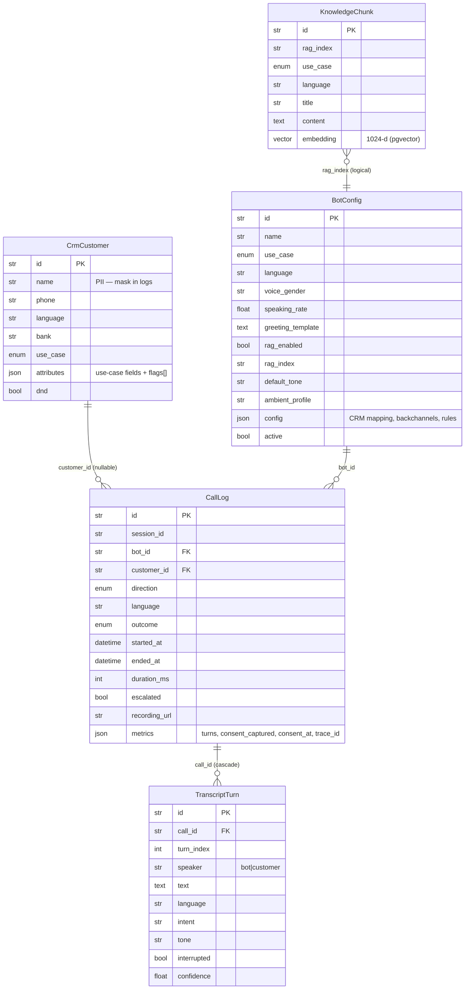
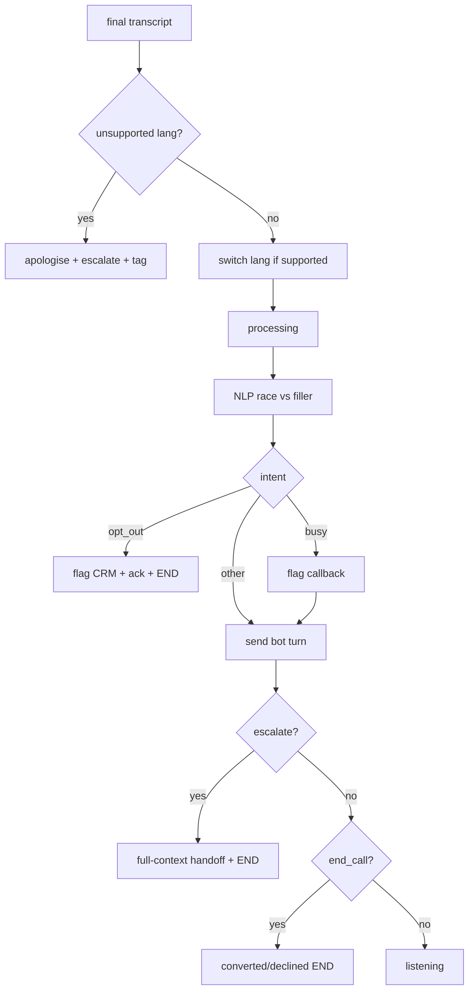
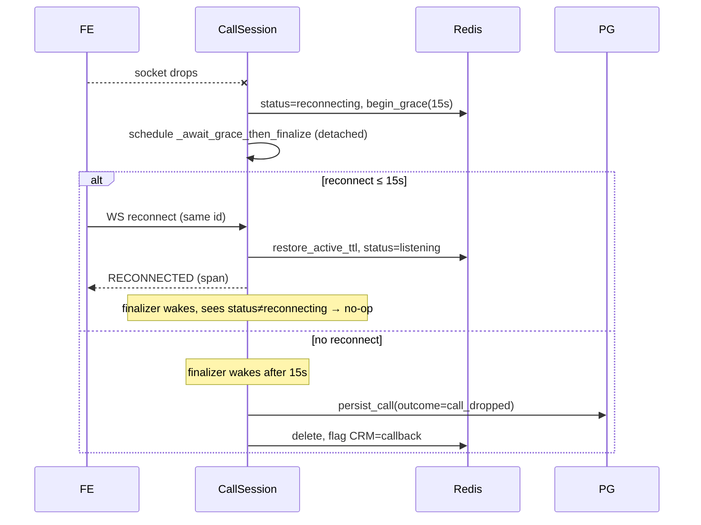

# KOEL Voice Bot — Low-Level Design (LLD)

> **⚠️ Superseded — see [`LLD_V2.md`](./LLD_V2.md) for the current system.**
> This document reflects the initial MVP boilerplate and is kept for historical
> reference only.

> Code-level design for the implemented MVP. Companion: [HLD.md](./HLD.md).
> Paths are relative to `backend/` unless noted. Line references are indicative.

---

## 1. Module layout

```
backend/koel/
├── common/              # shared infrastructure (inherited by every service)
│   ├── app_factory.py   # create_app(): docs, OTel, CORS, correlation+trace mw, /health
│   ├── auth.py          # JWT issue/decode, REST dep, WS auth, service principal
│   ├── config.py        # CommonSettings (KOEL_-prefixed, .env)
│   ├── logging.py       # JSON/console formatters, correlation ContextVar, PII masks
│   ├── telemetry.py     # OTel provider, span() ctx-mgr, current_trace_id()
│   ├── errors.py        # ApiError + envelope + exception handlers
│   └── schemas.py       # HealthResponse, Language, Tone enums
├── db/
│   ├── models.py        # SQLAlchemy: CrmCustomer, BotConfig, CallLog, TranscriptTurn, KnowledgeChunk
│   └── session.py       # async engine, sessionmaker, session_scope()
├── voicebot/            # VB_Svc — the orchestrator (port 8100)
│   ├── main.py          # app, lifespan (runtime + filler warm), WS endpoint
│   ├── config.py        # VoiceBotSettings (resilience thresholds)
│   ├── deps.py          # Runtime dataclass + build_runtime + get_runtime
│   ├── clients.py       # ServiceClients (httpx, svc-JWT, trace inject)
│   ├── persistence.py   # persist_call() → Postgres
│   ├── api/             # auth.py, bots.py, sessions.py, history.py (REST)
│   ├── ws/              # protocol.py (message envelopes), handler.py (CallSession)
│   ├── session/         # models.py (SessionState/Turn/CallStatus), store.py (Redis)
│   └── pipeline/        # orchestrator.py, bargein.py, filler.py, silence.py
├── stt/  nlp/  tts/     # AI microservices (main + providers + schemas; nlp also config + rag)
└── crm/                 # Dummy CRM (main + schemas + seed)
```

---

## 2. Shared core (`koel/common`)

### 2.1 `app_factory.create_app(...)`
Single entry point every service builds on. Wires uniformly:
- OpenAPI at `/docs`, `/redoc`, `/openapi.json`; `/health` (`HealthResponse`).
- **Correlation + trace middleware** (outermost after CORS): reads/mints `x-correlation-id`, sets the `ContextVar`, and `otel_context.attach(extract(headers))` so downstream manual spans are children of the caller's trace; detaches in `finally`.
- CORS (Bearer auth → `*` safe in dev), exception handlers, OTel resource.
- **Fail-fast:** raises in production if `jwt_secret` is the dev default.
- Accepts a custom `lifespan` (VB_Svc uses it to build the `Runtime` and warm the filler cache).

### 2.2 `auth.py`
- `TokenClaims{ sub, kind, role, iat, exp, jti }`; `TokenKind = "access" | "ws"`.
- `issue_token(subject, *, kind, role="operator", settings=None)` — HS256; TTL = `jwt_access_ttl_seconds` (3600) or `jwt_ws_ttl_seconds` (120).
- `decode_token(...)` validates signature + `kind`; raises `ApiError(401)` on mismatch.
- `require_access_token` (REST dep) → `CurrentUser` (Annotated). `require_service_principal` enforces `role=="service"` for AI/CRM endpoints (`ServicePrincipal`).
- `authenticate_websocket(ws)` — validates the `?token=` query param as a `ws` token **before** `accept()`; closes 1008 on failure; returns claims.

### 2.3 `logging.py`
- `_JsonFormatter` emits `{ts, level, logger, message, correlation_id, **extra_fields}`; `configure_logging` is idempotent.
- Correlation id in a `ContextVar` (set per request by middleware, per session by the WS handler).
- PII masks: `mask_name("Rahul Sharma") → "R. S."`, `mask_account(x) → "****1234"`.

### 2.4 `telemetry.py`
- `configure_telemetry` installs a `TracerProvider` once per process (OTLP exporter if `otel_exporter_otlp_endpoint`; console if `otel_console_export`).
- `span(name, **attrs)` — context manager that records exceptions + sets error status.
- `current_trace_id()` → 32-hex of the active span (persisted on the call).

### 2.5 `errors.py`
`ApiError(status_code, code, message, detail)` → envelope `{code, message, detail, correlation_id}`. Handlers: `ApiError`→its status (WARN), `RequestValidationError`→422, catch-all→500 (ERROR).

---

## 3. Data model (`koel/db/models.py`)



- `CallOutcome` enum: `converted, declined, escalated, no_answer, customer_unresponsive, call_dropped, unsupported_language, in_progress`.
- `UseCase`: `credit_card, collections, personal_loan, insurance, custom`.
- `session.py`: `get_engine()`/`get_sessionmaker()` (lru-cached); `session_scope()` async ctx-mgr (commit on success, rollback on error). Tests monkeypatch `get_sessionmaker` to an in-memory SQLite maker.

---

## 4. WebSocket protocol (`voicebot/ws/protocol.py`)

JSON envelopes; `ServerMessage.of(type, **data)` packs kwargs into `data`.

**Client → Server (`ClientMessageType`):**
| type | payload | meaning |
|---|---|---|
| `audio_chunk` | `audio_b64, is_final, sample_rate` | streamed mic audio (final = end-of-utterance) |
| `barge_in_candidate` | `data{partial_text, speech_duration_ms, language}` | Gate-1 VAD fired while bot spoke |
| `pong` | — | heartbeat reply (does NOT reset no-input) |
| `end_call` | — | user hung up |

**Server → Client (`ServerMessageType`):**
| type | key `data` fields |
|---|---|
| `call_state` | `status`, optional `reason`, escalation `transcript`+`crm_context` |
| `transcript` | `speaker, text, tone?, index` |
| `audio_chunk` | `audio_b64, duration_ms, index` |
| `tts_kill` | `reason, stop_target_ms` |
| `filler` | `text, audio_b64, tone` |
| `reconnected` | `text, last_turn` |
| `ping` | — |
| `error` | `code, message` |
| `call_ended` | `outcome, escalated, turns` |

---

## 5. Session state & store (`voicebot/session`)

### 5.1 `SessionState` (Pydantic, serialized to Redis on every mutation)
Identity: `session_id, bot_id, owner_sub, customer_id, use_case`. Config snapshot: `language, rag_enabled, rag_index, default_tone, ambient_profile, greeting_template, backchannels{lang:[...]}`. Runtime: `status (CallStatus), crm_context, transcript[Turn], last_confirmed_turn_index, no_input_strikes, escalated, outcome`. Audit: `consent_captured, consent_at, recording_url, trace_id`. Helpers: `add_turn`, `next_turn_index`, `recent_history(limit=8)`.

`Turn{ index, speaker, text, language, intent, tone, interrupted, confidence, at }`.

`CallStatus`: `connecting · bot_speaking · listening · processing · escalating · reconnecting · ended`.

### 5.2 `RedisSessionStore` (`store.py`)
Key `koel:session:{id}`. `save` (active TTL 3600 s), `load`, `begin_grace` (TTL→15 s on disconnect), `restore_active_ttl` (on reconnect; False if already expired), `delete`, `ping`.

---

## 6. The orchestrator (`voicebot/pipeline/orchestrator.py`)

Transport-agnostic: takes a `send: ServerMessage → Awaitable` callback.

- **`greet(state, send)`** — render `greeting_template` with CRM fields (`_render_template` fills `{key}`/`{customer.key}`/`{offer.key}`), force the automated-call disclosure, send the turn, set `consent_captured=True` + `consent_at=now`, → `listening`.
- **`_send_bot_turn(state, send, *, text, tone, intent=None, ambient=True)`** — append `Turn`, emit `call_state(bot_speaking)` + `transcript`, capture `trace_id` (first turn), call TTS (tone→prosody, ambient bed unless muted), emit `audio_chunk`.
- **`handle_final_transcript(state, send, stt)`** — reset no-input; append customer turn; **language fallback** (`_is_unsupported_language` → `_escalate_unsupported_language`, ambient muted); mid-call language switch (supported only); `processing`; **`_respond_with_filler`**; intent control flow.
- **`_respond_with_filler`** — `asyncio.wait_for(shield(nlp_task), timeout=filler_trigger_ms)`; on timeout inject a filler clip then await NLP.
- **Intent control flow:** `opt_out` → flag CRM + one ack + **end immediately**; `busy` → flag `callback`; then send the turn; `escalate` → `_escalate` (full-context handoff, `outcome=escalated`); `end_call` → `converted` if positive intent else `declined`.



### 6.1 Pipeline sub-modules
- **`bargein.BargeInClassifier`** — `evaluate(partial_text, speech_duration_ms, language, extra_backchannels=None)` → `BargeInDecision(interrupt, reason)`. Rules: `< backchannel_max_speech_ms` → `too_short`; normalised text ∈ (per-language dict ∪ per-bot `extra`) → `backchannel`; else `sustained_speech` (interrupt). Default dictionaries per EN/HI/Hinglish.
- **`filler.FillerCache`** — `load(language, clips)` (warmed at startup), `next_clip(session_id, language)` rotates and never repeats consecutively (per-session cursor); `filler_tone_for(use_case)`.
- **`silence.on_no_input(strikes, language)`** → `NoInputOutcome(action, text, event)`: strikes 0 → `reprompt`/`NO_INPUT_1`; ≥1 → `close`/`customer_unresponsive`. Localised prompt/close text.

---

## 7. WebSocket handler — `CallSession` (`voicebot/ws/handler.py`)

Owns one socket bound to one `SessionState`. Concurrency: a `_send_lock`; a heartbeat task; detached finalizer tasks held on `Runtime.background_tasks`.

**`run()`** → `accept()`; if `resumed` emit `RECONNECTED` inside a `ws.reconnected` span; else `greet`; persist; start `_heartbeat_loop`; `_receive_loop`; on `WebSocketDisconnect` → `_on_disconnect`.

**`_receive_loop()`** — deadline-based no-input timer:
```python
window_ms = no_input_reprompt_ms if strikes == 0 else no_input_close_ms
remaining = (self._last_input_at + window_ms/1000) - time.monotonic()
if remaining <= 0: await self._handle_no_input(); continue
raw = await wait_for(ws.receive_text(), timeout=remaining)
... if msg.type != pong: self._last_input_at = time.monotonic()   # pongs are NOT input
```
AI/turn errors → `_fail_call` (error frame + finalize once, never crash the socket).

**`_handle_barge_in(msg)`** — only while `_bot_speaking`; fold per-bot `backchannels[lang]` into `extra_backchannels`; on interrupt clear speaking, mark last bot turn `interrupted`, send `tts_kill(reason, stop_target_ms)`.

**`_handle_no_input()`** — log `outcome.event`; reprompt branch increments strikes + **resets `_last_input_at`** (fresh close window) + sends re-prompt; close branch → `customer_unresponsive`, CRM `retry`, `end_call`.

**`_heartbeat_loop()`** — every 5 s send `ping`; if `now - _last_pong > heartbeat_timeout_seconds` (12 s) close 1001 → receive loop raises → grace path.

**`_on_disconnect()`** (idempotent) — if `ended` → finalize; else `reconnecting` + `begin_grace` + schedule **`_await_grace_then_finalize`**.

**`_await_grace_then_finalize()`** — `sleep(grace_ttl)`; reload from store; if status moved off `reconnecting` → a reconnect owns it, return; else set `call_dropped`, flag CRM `callback`, `_finalize`.

**`_finalize()`** — exactly-once: `persist_call(state)`; on success `store.delete`; else leave on TTL for retry.



---

## 8. AI microservices

### 8.1 NLP (`koel/nlp`)
- **`schemas`**: `TurnContext{session_id, bot_id, use_case, language, customer_text, history, crm_context, rag_enabled, rag_index}`; `NlpResponse{session_id, response_text, intent, tone(req), escalate, escalation_reason, end_call, confidence, retrieved[]}`. `Intent` (11): high_interest, interested, objection, not_interested, busy, promise_to_pay, dispute, request_human, opt_out, smalltalk, unknown.
- **`config.NlpSettings`**: `nlp_provider("stub"|"groq")`, `groq_api_key`, `groq_base_url`, `groq_model="llama-3.3-70b-versatile"`, `groq_temperature=0.3`, `groq_max_tokens=512`, `groq_timeout_s=8.0`; `groq_enabled = provider=="groq" and api_key`.
- **`providers.GroqNlpProvider`** — builds a system prompt (Hinglish rules, intent/tone enums, anti-hallucination, JSON contract) + user prompt (use case, language, CRM, RAG chunks, last-8 history, customer turn); POST `…/chat/completions` with `response_format=json_object`; `_parse` coerces intent/tone (defaults on invalid), clamps confidence; **any exception → `StubNlpProvider` fallback**. `main._build_provider()` selects by `groq_enabled`; lifespan `aclose()`.
- **`StubNlpProvider`** — keyword intent heuristics, templated empathetic responses, repetition guard, per-use-case default tone.
- **`rag`**: `HashEmbedder` (deterministic stub) + `retrieve()` cosine-distance NN over `knowledge_chunks` scoped by `rag_index` (real pgvector query). Best-effort: failures degrade to no context.

### 8.2 STT (`koel/stt`)
`TranscribeRequest{session_id, audio_b64, sample_rate, is_final, language_hint}` → `TranscriptResult{text, is_final, language_id, language_confidence, speech_duration_ms, word_confidence}`. `StubWhisperProvider`: "type-to-talk" (`b"TEXT:"` prefix returned verbatim) + heuristic language detection (Marathi/Bengali/Tamil markers → `Language.other` @0.95 to exercise fallback). Real `WhisperSageMakerProvider` is a `NotImplementedError` seam.

### 8.3 TTS (`koel/tts`)
`SynthesizeRequest{session_id, text, language, tone, voice_gender, speaking_rate, stream, ambient, ambient_profile, ambient_gain}`. `TONE_PROSODY` maps each `Tone` → `Prosody{pitch, rate, energy}`; `resolve_prosody` multiplies rate by `speaking_rate`. `StubOrpheusProvider.synthesize` sizes PCM by text length/rate; **ambient bed** (`_ambient_pcm`, deterministic LCG low-amplitude noise) mixed when `ambient and ambient_profile`. `stream()` emits ~120 ms chunks for barge-in boundaries.

### 8.4 CRM (`koel/crm`)
Richardson-L2 over `crm_customers`: `GET /v1/customers`, `GET /{id}`, `POST /{id}/interactions` (201), `POST /{id}/flags` (201; `opt_out` also sets `dnd=True`; flags stored in `attributes.flags[]`). `seed.py` = 5 synthetic profiles (one per use case + a DND record). All endpoints require a `ServicePrincipal`.

---

## 9. Configuration reference (`KOEL_` env)

| Setting | Default | Purpose |
|---|---|---|
| `ENVIRONMENT` / `DEBUG` | development / true | env + debug |
| `AWS_REGION` | ap-south-1 | data residency |
| `JWT_SECRET` / `JWT_ALGORITHM` | dev secret / HS256 | token signing (fail-fast in prod) |
| `JWT_ACCESS_TTL_SECONDS` / `JWT_WS_TTL_SECONDS` | 3600 / 120 | token TTLs |
| `REDIS_URL` / `DATABASE_URL` | localhost | session + data stores |
| `STT/NLP/TTS/CRM_SVC_URL` | localhost:8101-4 | fan-out targets |
| `NLP_PROVIDER` / `GROQ_API_KEY` / `GROQ_MODEL` | stub / — / llama-3.3-70b | live NLP selection |
| `TURN_LATENCY_BUDGET_MS` | 300 | budget |
| `BACKCHANNEL_MAX_SPEECH_MS` / `BARGE_IN_STOP_TARGET_MS` | 300 / 150 | barge-in |
| `FILLER_TRIGGER_MS` | 300 | latency masking |
| `NO_INPUT_REPROMPT_MS` / `NO_INPUT_CLOSE_MS` | 5000 / 5000 | silence rules |
| `SESSION_GRACE_TTL_SECONDS` / `SESSION_ACTIVE_TTL_SECONDS` | 15 / 3600 | reconnect window / TTL |
| `HEARTBEAT_INTERVAL_SECONDS` / `HEARTBEAT_TIMEOUT_SECONDS` | 5 / 12 | liveness |
| `LANGUAGE_CONFIDENCE_THRESHOLD` | 0.6 | unsupported-lang escalate |
| `ENFORCE_CALLING_HOURS` / `CALLING_HOURS_START` / `_END` | false / 9 / 21 | RBI window |

---

## 10. REST API reference (all JWT-protected unless noted)

| Method | Path | Auth | Notes |
|---|---|---|---|
| POST | `/v1/auth/login` | none | `{username,password}` → `{access_token}` (seeded `demo`/`koel-demo`) |
| POST | `/v1/auth/ws-token` | access | → short-lived `ws_token` |
| GET / POST / GET | `/v1/bots` · `/v1/bots` · `/v1/bots/{id}` | access | list / create(201) / get(404) |
| POST | `/v1/sessions` | access | start call; CRM fetch, **DND→409**, **RBI hours→403**, DPDP-minimised ctx; → `session_id`+`ws_token`. Bot inactive/missing→404 |
| GET / GET | `/v1/calls` · `/v1/calls/{id}` | access | history (filters bot/outcome/language, limit≤200) / detail+transcript(404) |
| GET | `/v1/customers` · `/{id}` · POST flags/interactions | **service** | internal CRM contract |
| WS | `/ws/calls/{session_id}?token=` | **ws-token** | upgrade rejected 1008 if invalid / not owner / unknown / expired |
| GET | `/health`, `/docs` | none | every service |

---

## 11. Token & trace flows

- **REST:** `Authorization: Bearer <access>` → `require_access_token` → `TokenClaims`.
- **WS:** `POST /v1/sessions` returns a `ws` token; client opens `…?token=`; `authenticate_websocket` validates kind+sig before `accept()`; `main.call_socket` checks `claims.sub == state.owner_sub` and `restore_active_ttl` on resume.
- **Service-to-service:** `ServiceClients._headers()` mints a fresh `role=service` access token per fan-out, adds `x-correlation-id`, and `inject(headers)` (W3C `traceparent`). Inbound middleware `extract`s it → manual spans stitch into one trace; `current_trace_id()` is persisted on the call.

---

## 12. Key algorithms (summary)

1. **Dual-gate barge-in** — Gate 1 client VAD; Gate 2 duration+dictionary classification (per-language ∪ per-bot). §6.1 / `bargein.py`.
2. **Filler racing** — `wait_for(shield(nlp), filler_trigger_ms)`; inject rotated clip on timeout. `orchestrator._respond_with_filler`.
3. **Pong-independent no-input** — deadline from `_last_input_at`; pongs don't reset; reprompt restarts the clock. `handler._receive_loop`.
4. **Dropped-call finalizer** — detached task after grace TTL; reconnect-aware; exactly-once persist + CRM callback. `handler._await_grace_then_finalize`.
5. **Language fallback** — unsupported `language_id` ≥ threshold → apologise + escalate + tag. `orchestrator._is_unsupported_language`.
6. **Tone → prosody** — `TONE_PROSODY[tone]` × `speaking_rate`. `tts/providers.resolve_prosody`.
7. **Ambient mixing** — deterministic LCG noise bed under TTS; muted on handoff. `tts/providers._ambient_pcm`.

---

## 13. Testing strategy (`backend/tests`, 37 tests)

- **Unit:** `test_bargein` (Gate 2), `test_silence_and_filler` (no-input + rotation), `test_nlp_conversation` (stub quality), `test_auth_and_prosody` (JWT + tone→prosody), `test_audit_fixes` (PII mask + service authZ), `test_resilience_fixes` (per-bot dict, ambient, immediate opt-out).
- **Integration** (`conftest.py`: in-memory **SQLite** via monkeypatched `get_sessionmaker`, `FakeStore`, `FakeClients`, app over `httpx.ASGITransport`, minted JWT):
  - `test_sessions_api` — DPDP minimisation, recording_url/backchannels seeding, DND 409, inactive 404, RBI hours 403/201, unauth 401.
  - `test_persistence` — `persist_call` round-trip (outcome coercion, audit metrics, transcript turns).
  - `test_ws_finalizer` — grace-expiry → `call_dropped` + CRM callback + persist; reconnect suppresses it.
- **Live drivers:** `scripts/demo_call.py` (happy path) and `scripts/demo_resilience.py` (dropped/reconnect/no-input) against `docker compose` — used to verify end-to-end with real Groq + Postgres + Redis.
- **Gates:** `pytest -q`, `ruff check`, `mypy` (3 pre-existing stub-import warnings only).

---

## 14. Extension seams

| To add | Where |
|---|---|
| Real Whisper STT | implement `WhisperSageMakerProvider` (or a `GroqWhisperProvider` mirroring `GroqNlpProvider`); select in `stt/main.py` |
| Real Orpheus TTS | implement `OrpheusSageMakerProvider.synthesize/stream`; select in `tts/main.py` |
| Real embeddings | replace `HashEmbedder` with a Titan/embedding client in `nlp/rag.py` |
| Telephony (PSTN) | new transport calling the same `Orchestrator` (it only needs a `send` callback) |
| New use case / bot | `POST /v1/bots` config row — no code (the product's moat) |
